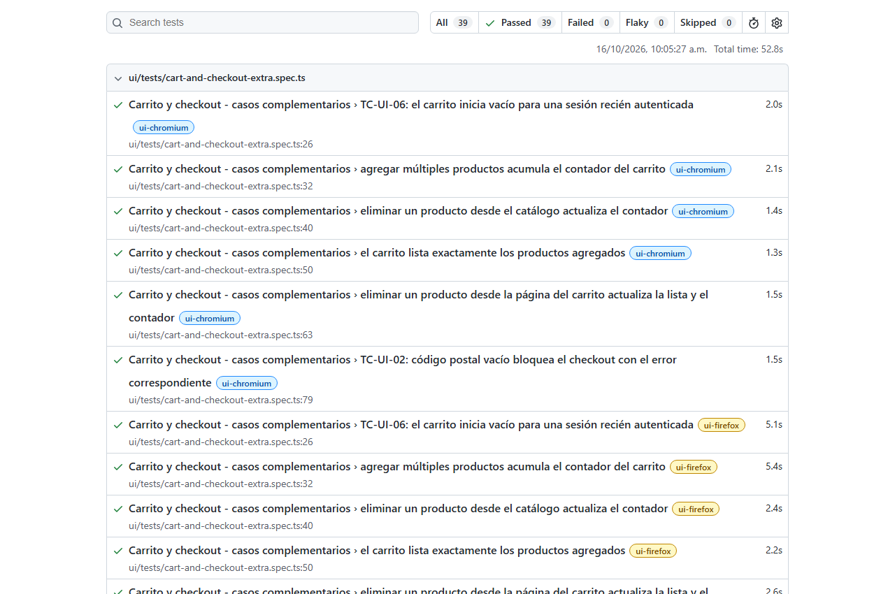
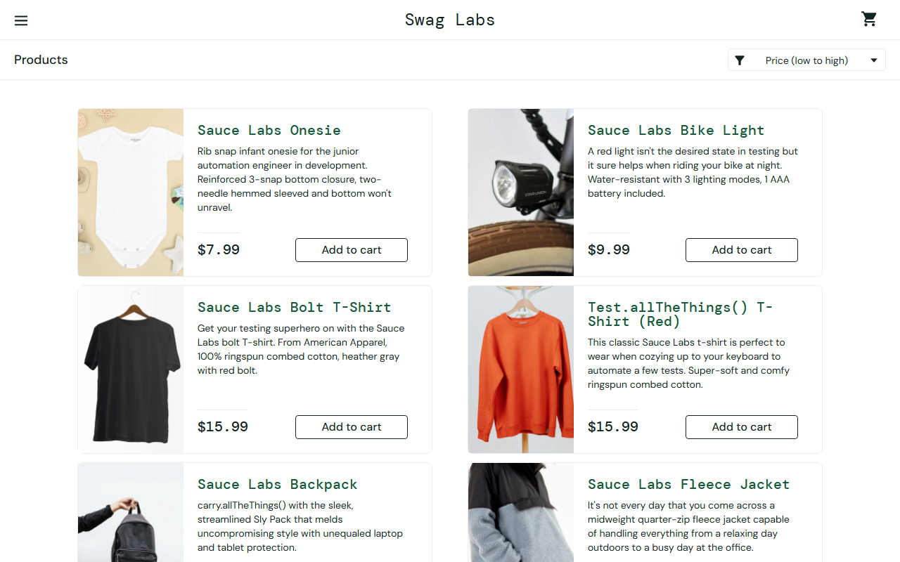
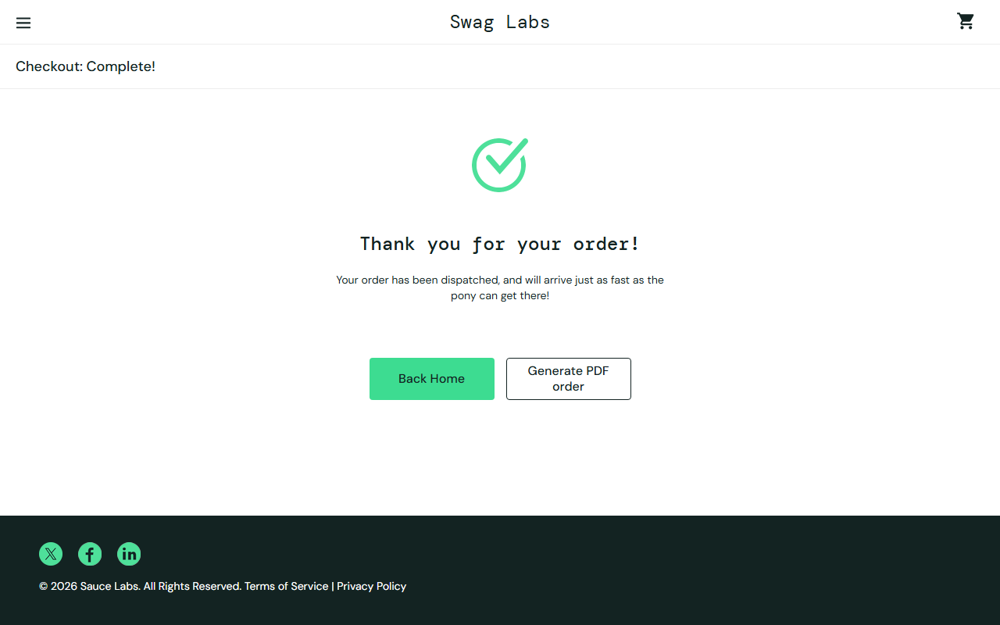
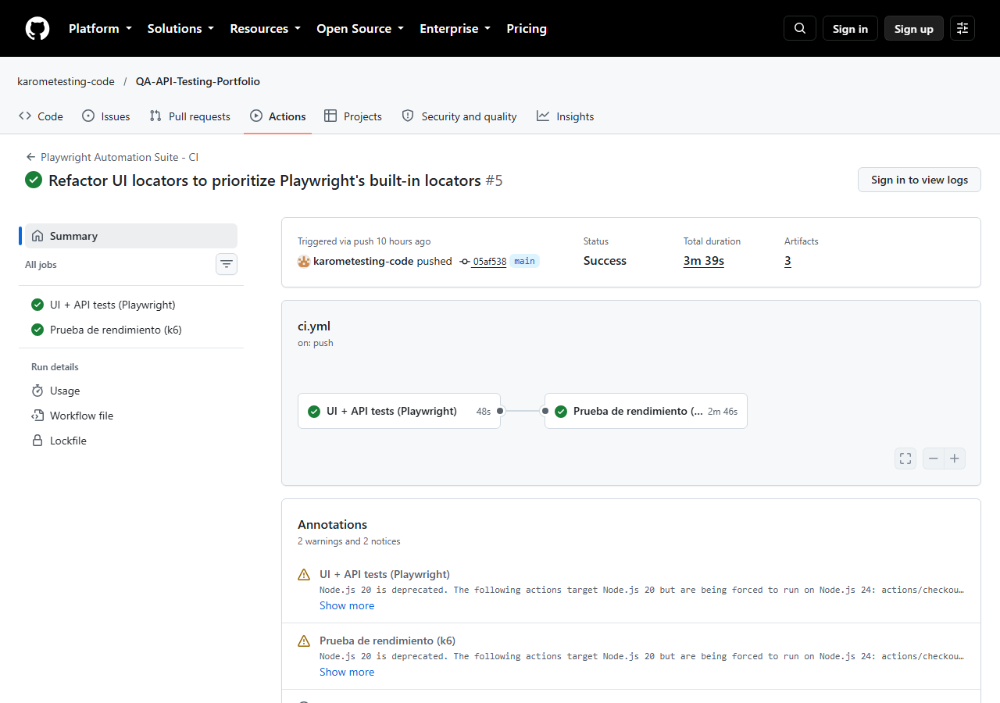
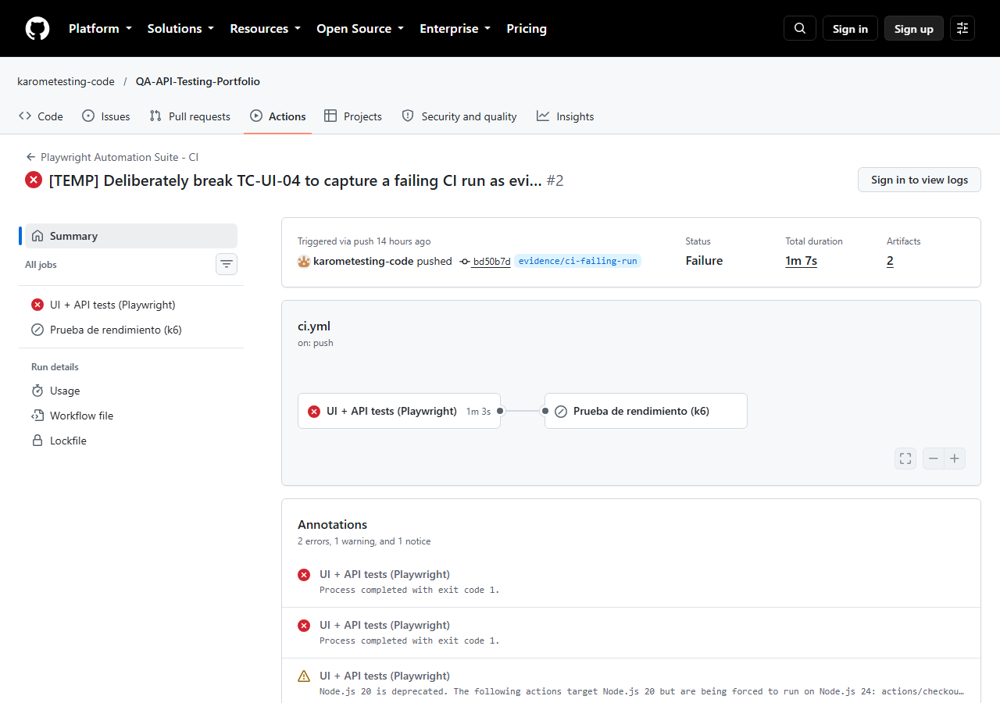

# Playwright Automation Suite — UI + API + Performance + CI/CD

Suite de automatización end-to-end: UI y API con Playwright, rendimiento con k6, CI/CD con GitHub Actions. Ciclo completo de QA — planeación, casos, automatización, performance, pipeline y hallazgos — en un repositorio.

Ejecutada de punta a punta contra las apps reales, no solo escrita. Esa ejecución real encontró y corrigió **6 defectos documentados** — ver [`documentation/03-reporte-hallazgos.md`](documentation/03-reporte-hallazgos.md).

## Qué cubre

| Capa | Herramienta | Qué valida |
|---|---|---|
| UI | Playwright + TS, cross-browser | [SauceDemo](https://www.saucedemo.com): selección dinámica por precio, fórmula Subtotal+Impuesto=Total, carrito, login |
| API | Playwright `APIRequestContext` | [Restful Booker](https://restful-booker.herokuapp.com): ciclo CRUD completo de una reserva + negativos |
| Performance | k6 | `GET /booking`, 10 VUs / 30s ramp-up / 2min |
| CI/CD | GitHub Actions | Triggers push + PR, reportes como artefactos |

## Herramientas y por qué

| Herramienta | Por qué |
|---|---|
| Playwright + TypeScript | Un framework para UI y API, auto-waiting nativo, cross-browser sin config extra |
| k6 | JS (mismo ecosistema del repo), liviano, integra nativo con GitHub Actions |
| GitHub Actions | Triggers nativos, artefactos integrados, runners con navegadores preinstalables |

Detalle completo (riesgos, priorización, criterios entrada/salida) en [`documentation/01-estrategia-de-pruebas.md`](documentation/01-estrategia-de-pruebas.md).

## Instalación y ejecución

```bash
npm install
npx playwright install --with-deps chromium firefox webkit
```

No requiere variables de entorno: SauceDemo y Restful Booker usan credenciales públicas de práctica, ya incluidas en el código.

```bash
npm run test:ui                # UI, Chromium (el que corre en CI)
npm run test:ui:all-browsers   # UI, Chromium + Firefox + WebKit
npm run test:api               # API
npm run test:all               # UI (Chromium) + API
npm run test:headed            # UI con navegador visible
npm run test:report            # Abre el último reporte HTML
npm run typecheck              # tsc --noEmit
npm run perf:booking           # k6 (requiere k6 instalado)
```

- Playwright genera reporte HTML (`reports/html-report/`) y JUnit (`reports/junit/`) en cada corrida
- k6 imprime resumen en consola + guarda `reports/performance/k6-summary.json`
- En CI ambos se publican como artefactos descargables (pestaña *Actions*)
- El workflow vive en `/.github/workflows/ci.yml` (raíz del repo, no en esta carpeta) — GitHub Actions solo descubre workflows ahí (ver `DEF-05`)

## Resultados (última ejecución real)

**39/39 tests UI** en verde (Chromium + Firefox + WebKit) · **3/3 tests API** en verde · **`npm run typecheck`** limpio



**Compra real contra SauceDemo:**

<table>
<tr>
<td></td>
<td></td>
</tr>
</table>

**Performance — `GET /booking`, k6, 10 VUs / 30s ramp-up / 2min:**

| Métrica | Resultado | Umbral | Cumple |
|---|---|---|---|
| Peticiones totales | 1138 | — | — |
| Tiempo promedio | 219.91 ms | — | — |
| P90 | 238.29 ms | < 1500 ms | ✅ |
| P95 | 299.78 ms | < 2500 ms | ✅ |
| Throughput | 7.07 req/s | — | — |
| % errores | 0.09% (DNS del cliente, no del servidor) | < 5% | ✅ |

**¿Soporta la carga?** Sí, con holgura de 5x+ sobre los umbrales. Matices y análisis completo en [`01-estrategia-de-pruebas.md`](documentation/01-estrategia-de-pruebas.md).

## Pipeline CI/CD — evidencia real

| Exitosa | Fallida (intencional) |
|---|---|
|  |  |
| [Ver run](https://github.com/karometesting-code/QA-API-Testing-Portfolio/actions/runs/38850296954) | [Ver run](https://github.com/karometesting-code/QA-API-Testing-Portfolio/actions/runs/38828517953) |

- La corrida fallida rompió TC-UI-04 a propósito (badge esperado `'99'`) para probar que el pipeline detecta y reporta fallos reales
- Reportes se publican como artefactos incluso cuando falla (`if: always()`)
- Rama temporal ya eliminada; el run queda visible permanentemente en *Actions*, enlazado a su commit

## Hallazgos — resumen

6 defectos reales encontrados ejecutando la suite (no simulados). Detalle completo con evidencia en [`documentation/03-reporte-hallazgos.md`](documentation/03-reporte-hallazgos.md):

| ID | Qué | Severidad | Estado |
|---|---|---|---|
| DEF-01/02 | `locator.count()` leía el DOM antes de que navegara la página | Alta | ✅ Corregido |
| DEF-03 | API acepta `totalprice` inválido y lo corrompe a `null` | Media | ⚠️ API de terceros |
| DEF-04 | Error de tipos TS que el test runner no detectaba | Baja | ✅ Corregido |
| DEF-05 | El pipeline nunca se habría ejecutado (ruta del workflow) | Crítica | ✅ Corregido |
| DEF-06 | `waitForURL()` resuelve antes de que la página cargue | Alta | ✅ Corregido |
| DEF-07 | SauceDemo muestra montos con error de punto flotante | Baja | ⚠️ App de terceros |

## Decisiones técnicas

- **Un framework (Playwright) para UI y API** — un repo, un pipeline, una curva de aprendizaje
- **Selección 100% dinámica en Flujos 1 y 2** — nunca por nombre/posición fija (requisito del enunciado); las pruebas de regresión complementarias sí usan nombres fijos a propósito, por legibilidad
- **Cero esperas fijas** — solo auto-waiting y esperas explícitas. Causa raíz de los defectos DEF-01/02/06
- **Ejecución real antes de dar por terminada la entrega** — encontró 3 bugs de sincronización que una revisión de código no detecta
- **Locators integrados por encima de CSS manual** — ver abajo
- **CI corre solo Chromium** — Firefox/WebKit disponibles en local (`npm run test:ui:all-browsers`); mantiene el pipeline rápido

## Estrategia de locators

Orden de prioridad (el que recomienda Playwright):

1. **`getByRole` / `getByLabel` / `getByPlaceholder`** — el elemento tiene rol ARIA y nombre accesible real (botones, inputs, `role="alert"`). Así identifica un elemento un usuario real, no un detalle de implementación.
2. **`getByTestId`** — sin rol útil pero con atributo de prueba. SauceDemo usa `data-test` (no el `data-testid` por defecto), así que se configuró `testIdAttribute: 'data-test'` en `playwright.config.ts`.
3. **CSS manual (`page.locator(...)`)** — último recurso, solo si no hay ni rol ni test id. Casi no se necesitó: SauceDemo cubre con `data-test` casi todo.

Por qué importa el orden: un rol describe *qué es* el elemento (resistente a cambios de estilo); un `data-test` solo dice *que alguien lo marcó para pruebas* (más estable que una clase CSS, pero no garantiza que sea interactuable como lo haría un usuario real).

## Estructura

```
Playwright-Automation-Suite/
├── ui/
│   ├── fixtures/users.ts
│   ├── pages/              # Page Object Model
│   ├── tests/
│   │   ├── flow1-purchase.spec.ts          # TC-UI-01 (enunciado)
│   │   ├── flow2-cart.spec.ts              # TC-UI-04 (enunciado)
│   │   ├── login.spec.ts                   # regresión
│   │   └── cart-and-checkout-extra.spec.ts # regresión
│   └── utils/money.ts
├── api/tests/ · api/utils/
├── performance/load-test-booking.js
├── reports/                # generados (gitignored salvo estructura)
├── documentation/
│   ├── 01-estrategia-de-pruebas.md
│   ├── 02-casos-de-prueba.md
│   ├── 03-reporte-hallazgos.md
│   ├── 04-feedback-conclusiones.md
│   └── images/
├── playwright.config.ts · package.json · tsconfig.json
```

## Documentación

- [Estrategia de pruebas](documentation/01-estrategia-de-pruebas.md)
- [Casos de prueba](documentation/02-casos-de-prueba.md)
- [Reporte de hallazgos](documentation/03-reporte-hallazgos.md)
- [Feedback y conclusiones](documentation/04-feedback-conclusiones.md)

## Autora

**Karen Romero** — QA Engineer Portfolio · [GitHub](https://github.com/karometesting-code)
