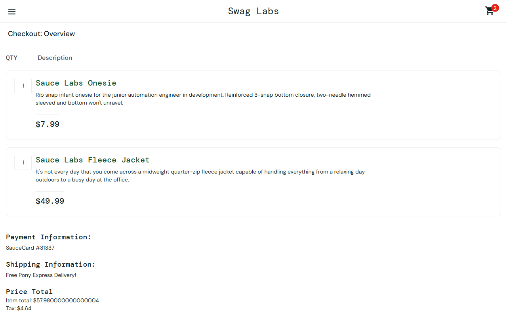

# Reporte de hallazgos

Suite ejecutada de punta a punta contra `saucedemo.com` y `restful-booker.herokuapp.com` (no solo escrita y asumida correcta). Todos los hallazgos de abajo salieron de esa ejecución real.

**Resumen rápido:**

| ID | Hallazgo | Tipo | Severidad | Estado |
|---|---|---|---|---|
| [DEF-01](#def-01) | Carrito leído 0 ítems justo tras navegar | Automatización | Alta | ✅ Corregido |
| [DEF-02](#def-02) | Catálogo leído 0 productos en WebKit | Automatización | Alta | ✅ Corregido |
| [DEF-03](#def-03) | API acepta `totalprice` inválido y lo corrompe | Producto (API) | Media | ⚠️ Confirmado, no corregible (API de terceros) |
| [DEF-04](#def-04) | Error de tipos TypeScript no detectado por el test runner | Automatización | Baja | ✅ Corregido |
| [DEF-05](#def-05) | El pipeline de CI nunca se habría ejecutado | Automatización | Crítica | ✅ Corregido |
| [DEF-06](#def-06) | `waitForURL()` resuelve antes de que la página cargue | Automatización | Alta | ✅ Corregido |
| [DEF-07](#def-07) | SauceDemo muestra montos con error de punto flotante | Producto (UI) | Baja | ⚠️ Confirmado, no corregible (app de terceros) |

---

## DEF-01

**Carrito leído con 0 ítems justo después de navegar (Chromium, intermitente)**

- **Componente:** `CartPage.getItemsWithPrices()`
- **Causa:** usaba `locator.count()` justo después de `goToCart()`, sin esperar a que `cart.html` terminara de renderizar
- **Síntoma:** `cartItems.length === 0` aunque el carrito tenía 3 productos
- **Fix:** espera explícita al primer ítem antes de contar
- **Evidencia:** falla reproducida en la primera corrida real; corregido y verificado en corridas posteriores

## DEF-02

**Catálogo leído con 0 productos (WebKit, consistente 3/3)**

- **Componente:** `InventoryPage.getProductsWithPrices()`
- **Causa:** mismo patrón que DEF-01, justo después del login
- **Síntoma:** reproducido de forma determinística 3/3 veces (`--workers=1 --repeat-each=3`), descartando que fuera un problema de paralelismo
- **Fix:** espera explícita al primer producto antes de contar
- **Evidencia:** diagnosticado con un script aislado que confirmó `count() === 0` justo tras `waitForURL`

## DEF-03

**`POST /booking` acepta `totalprice` con tipo incorrecto y lo corrompe a `null`**

- **Pasos:** `POST /booking` con `"totalprice": "cien"` (string en vez de number)
- **Esperado:** `400 Bad Request`
- **Real:** `200 OK`, y el campo se guarda como `null` (no como el valor enviado)
- **Severidad:** Media — es una API pública de práctica, no productiva; en un sistema real de pagos sería Alta
- **Estado:** no corregible desde este repo (API de terceros). Documentado como candidato de regresión (TC-API-04 en `02-casos-de-prueba.md`), no automatizado como assertion fija porque el comportamiento podría cambiar sin aviso

```json
// Respuesta real capturada (booking de prueba eliminado inmediatamente después)
{"bookingid":4770,"booking":{"firstname":"TypeTest","lastname":"Romero","totalprice":null,...}}
```

## DEF-04

**Error de tipos TypeScript (modo `strict`) que el test runner no detectaba**

- **Componente:** `api/tests/booking-crud.spec.ts`
- **Causa:** `toMatchObject()` recibía un tipo `Booking` sin index signature
- **Por qué importa:** el test *pasaba* en ejecución (Playwright transpila sin chequeo de tipos completo) pero el código no compilaba con `tsc --noEmit`
- **Fix:** cast explícito + se agregó `npm run typecheck` como script y como paso de CI, para que esto no vuelva a pasar inadvertido

## DEF-05

**El pipeline de CI nunca se habría ejecutado — ubicación incorrecta del workflow**

- **Causa:** el archivo estaba en `Playwright-Automation-Suite/.github/workflows/ci.yml`; GitHub Actions **solo** indexa workflows en `.github/workflows/` en la **raíz** del repositorio
- **Confirmado vía API:** `GET /actions/workflows` devolvía `"total_count": 0`
- **Severidad:** Crítica — invalidaba por completo el entregable de pipeline
- **Fix:** se movió el archivo a la raíz, con `paths` filters para que solo corra por cambios en este proyecto

## DEF-06

**`page.waitForURL()` puede resolver antes de que la página destino termine de renderizar**

Causa raíz más profunda detrás de DEF-01/DEF-02, encontrada al endurecer el refactor de locators con una batería de estrés (`--workers=1 --repeat-each=10` en WebKit, 2/80 corridas fallaban).

- **El problema:** el navegador actualiza la URL casi al *iniciar* la navegación, no cuando *termina* de cargar. `waitForURL()` se resolvía en ~12ms (confirmado con la traza real de Playwright) — demasiado rápido para una carga real.
- **Dos síntomas del mismo bug:**
  - Lectura: `cartItems` leía los 6 productos del catálogo viejo en vez de los 2 del carrito nuevo
  - Escritura: `CheckoutPage.fillInfo()` llenaba el campo "First Name" mientras la página aún se hidrataba — el valor se perdía silenciosamente (sin error), mientras los campos siguientes sí se guardaban
- **Fix:**
  - Cada navegación ahora espera además un elemento **exclusivo** de la página destino (no solo la URL)
  - Las lecturas de listas (`getProductsWithPrices`, `getItemsWithPrices`, `getItemNames`) pasaron de `.count()` + bucle de `.nth(i)` a `locator.evaluateAll()` (una sola llamada atómica)
- **Verificado:** 80/80 corridas en verde tras el fix (antes: 78/80)
- **Lección:** una corrida verde una sola vez no es evidencia suficiente de que una condición de carrera está resuelta — hace falta estresarla con repeticiones

## DEF-07

**SauceDemo muestra montos con error de precisión de punto flotante**

- **Dónde:** página de resumen de checkout (`checkout-step-two.html`)
- **Ejemplo real:** al comprar el producto más barato ($7.99) y el más caro ($49.99), el subtotal se muestra como **`$57.980000000000004`** en vez de `$57.98`
- **Causa:** la app hace `7.99 + 49.99` en JavaScript sin redondear el resultado antes de mostrarlo (clásico error de `IEEE 754`)
- **Por qué importa:** valida una decisión de diseño de esta suite — `expectMoneyEqual()` compara montos con tolerancia de 1 centavo en vez de igualdad exacta, precisamente para no fallar por este tipo de imprecisión
- **Estado:** no corregible desde este repo (app de terceros); documentado como hallazgo de UI


